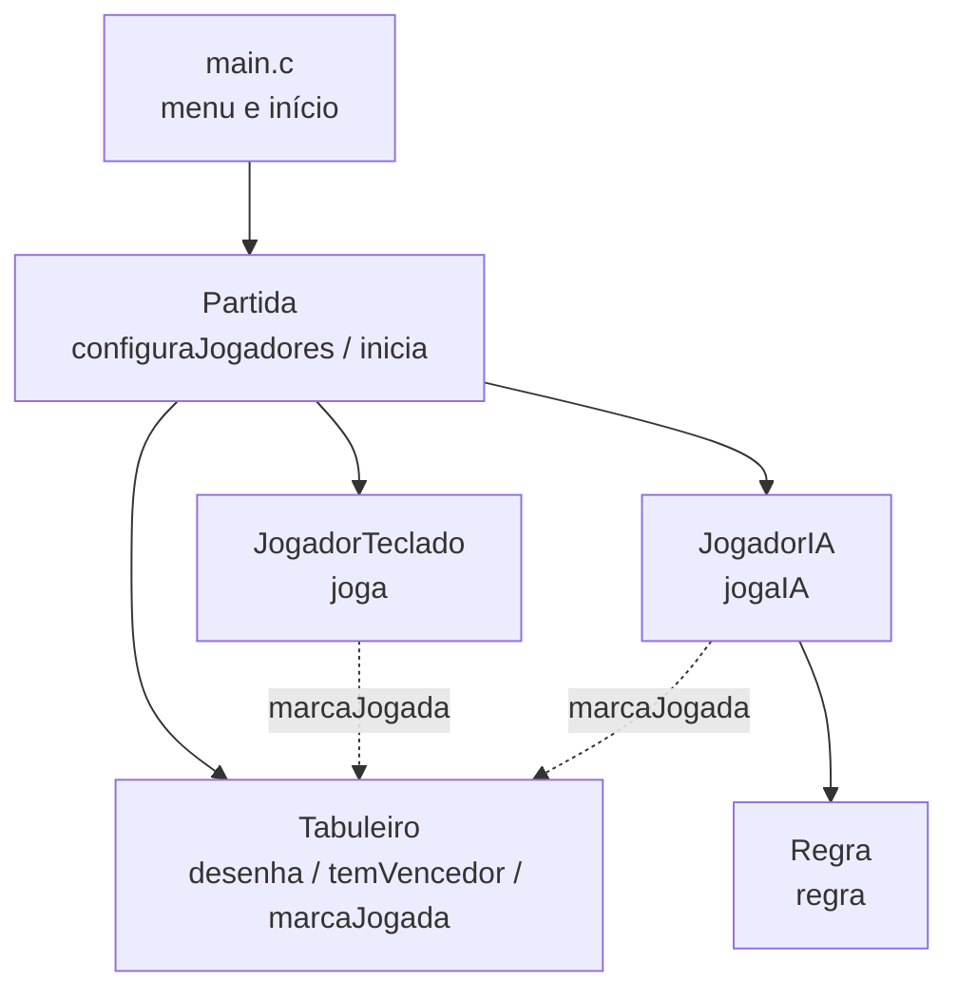

# 🎮 Jogo da Velha em C

Jogo da Velha no terminal, escrito em **C** para a disciplina de **Programação Estruturada**. O jogador humano pode enfrentar outro humano ou um **computador com IA baseada em regras**.

> **Status do projeto**
> ✅ Atividade 1 — Módulo Jogo de Tabuleiro
> ✅ Atividade 2 — Módulo IA
> ⏳ Atividade 3 — Módulo Jogador Remoto (em breve)

**Autores:** Gabriela Francisca Alves da Silva · Heloísa Stella Azevedo Reis

---

## 📑 Sumário

- [Como jogar](#-como-jogar)
- [Compilação e execução](#-compilação-e-execução)
- [Estrutura do projeto](#-estrutura-do-projeto)
- [Arquitetura](#-arquitetura)
- [Atividade 1 — Tabuleiro e jogador humano](#-atividade-1--tabuleiro-e-jogador-humano)
- [Atividade 2 — IA](#-atividade-2--ia)
- [Próximos passos](#-próximos-passos)

---

## 🕹️ Como jogar

Ao executar, escolha o modo de jogo:

```
=== JOGO DA VELHA ===
1 - Humano x Humano
2 - Humano x Computador
Escolha o modo de jogo:
```

- O **primeiro jogador é sempre humano** e joga com **X**. O segundo joga com **O**.
- Na sua vez, digite a **linha** e a **coluna** (de 1 a 3) separadas por espaço. Exemplo: `2 2` marca o centro.
- O tabuleiro é redesenhado após cada jogada.
- Vence quem formar três marcações iguais em linha, coluna ou diagonal. Se as 9 casas forem preenchidas sem vencedor, o jogo termina em **empate** ("deu velha").

Exemplo de tabuleiro na tela:

```
X|O|X
-----
 |O| 
-----
 |X| 
```

O programa valida a entrada e avisa quando você digita algo que não é número, uma posição fora do tabuleiro ou uma casa já ocupada, pedindo a jogada de novo.

---

## ⚙️ Compilação e execução

**Requisitos:** GCC e um terminal com suporte a sequências ANSI (Linux, macOS, WSL ou Windows Terminal). A tela é limpa com `printf("\033[2J\033[H");`.

```bash
gcc -Wall -o jogo_velha main.c tabuleiro.c jogadorTeclado.c jogadorIA.c regra.c partida.c
./jogo_velha
```

---

## 🗂️ Estrutura do projeto

```
.
├── main.c               # Menu e inicialização da partida
├── partida.h / .c       # Controle do loop do jogo
├── tabuleiro.h / .c     # Matriz, desenho e detecção de vencedor
├── jogadorTeclado.h / .c# Jogador humano (entrada pelo teclado)
├── jogadorIA.h / .c     # Jogador computador
├── regra.h / .c         # Regras usadas pela IA
└── README.md
```

---

## 🧱 Arquitetura

O diagrama UML do enunciado foi traduzido para C: cada classe virou um **módulo** (par `.h`/`.c`), e os atributos viraram **structs**.



| Entidade (UML) | Implementação em C | Responsabilidade |
|---|---|---|
| `Partida` | `partida.c` | `configuraJogadores()` cria um jogador; `inicia()` roda o loop da partida |
| `Tabuleiro` | `tabuleiro.c` | Funções que recebem a matriz `M[3][3]` como parâmetro |
| `JogadorTeclado` | `jogadorTeclado.c` | `struct jogadorTeclado` + `joga()` |
| `JogadorIA` | `jogadorIA.c` | `struct jogadorIA` + `jogaIA()` |
| `Regra` | `regra.c` | Função `regra()` que avalia uma regra por número |

Para a `Partida` aceitar qualquer combinação de jogadores, ela usa uma `struct jogador` com um campo `modo` (`HUMANO` ou `COMPUTADOR`). A função interna `jogaJogador()` chama `joga()` ou `jogaIA()` conforme o modo. Os nomes diferentes (`joga` e `jogaIA`) evitam conflito de símbolos, já que C não tem sobrecarga de funções.

---

## 🧩 Atividade 1 — Tabuleiro e jogador humano

### Representação do tabuleiro

O tabuleiro é uma matriz `int M[3][3]` com os valores:

| Valor | Significado |
|:-----:|-------------|
| `0` | Casa vazia |
| `1` | Casa marcada com **O** |
| `4` | Casa marcada com **X** |

### Funções do `Tabuleiro`

| Função | O que faz |
|---|---|
| `desenha(M)` | Limpa a tela e desenha o tabuleiro a partir da matriz |
| `marcaJogada(M, x, y, tipo)` | Grava a marcação do jogador na posição (x, y), com índices de 0 a 2 |
| `temVencedor(M)` | Retorna o estado da partida (veja abaixo) |

### Como o vencedor é identificado

A função soma cada linha, coluna e diagonal:

- soma **3** (1 + 1 + 1) → **O** venceu;
- soma **12** (4 + 4 + 4) → **X** venceu;
- sem vencedor e sem casas vazias → **empate**.

Os valores 1 e 4 garantem que nenhuma outra combinação de três casas resulte em 3 ou 12.

O retorno de `temVencedor()` usa o `enum resultado`:

```c
enum resultado { JOGADOR_X, JOGADOR_O, EMPATE, EM_JOGO };
```

`EM_JOGO` indica que ninguém ganhou e ainda há casas livres, então a partida continua.

### Jogador humano

`joga()` lê linha e coluna (1 a 3), converte para índices de 0 a 2 e repete a leitura até a jogada ser válida. Se a entrada for encerrada (Ctrl+D), o programa sai normalmente.

---

## 🤖 Atividade 2 — IA

`jogaIA()` testa as regras **na ordem** e executa a primeira que gerar uma jogada. A IA deduz o símbolo do adversário a partir do próprio, então funciona como X ou como O.

| Caso em `regra()` | Regra do enunciado | O que a IA faz |
|:-:|:-:|---|
| 1 | **R1** | Se ela tem duas marcações em sequência, completa a linha e **vence** |
| 2 | **R1** | Se o adversário tem duas em sequência, **bloqueia** a casa restante |
| 3 | **R2** | Escolhe uma jogada que cria duas sequências de duas marcações (*fork*) |
| 4 | **R3** | Marca o centro, se estiver livre |
| 5 | **R4** | Se o adversário tem um canto, marca o canto oposto |
| 6 | **R5** | Marca um canto vazio |
| 7 | **R6** | Marca qualquer casa vazia |

A R1 do enunciado aparece em dois casos (1 e 2): primeiro a IA tenta ganhar e só depois bloqueia o adversário.

`regra()` retorna `1` quando a regra gerou uma jogada (devolvida pelos ponteiros `linhaEscolhida` e `colunaEscolhida`) e `0` quando não se aplica.

---

## 🔜 Próximos passos

**Atividade 3 — Jogador Remoto:** comunicação cliente-servidor por sockets TCP. Serão dois programas: o **servidor** (espera a conexão e joga primeiro, como X) e o **cliente** (pede a conexão e joga como O), alternando as jogadas até haver vitória ou empate.

## 📅 Cronograma

| Atividade | Módulo | Apresentação |
|:-:|---|:-:|
| 1 | Jogo de Tabuleiro | 27/10/2026 |
| 2 | IA | 27/10/2026 |
| 3 | Jogador Remoto | 03/11/2026 |
