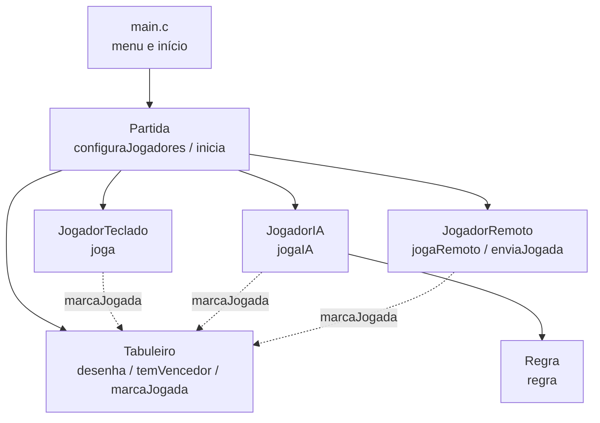

# 🎮 Jogo da Velha em C

Jogo da Velha no terminal, escrito em **C** para a disciplina de **Programação Estruturada**. O jogador humano pode enfrentar outro humano, um **computador com IA baseada em regras** ou um **adversário remoto** em outro programa (mesma máquina ou outro computador, via sockets TCP).

> **Status do projeto**
> ✅ Atividade 1 — Módulo Jogo de Tabuleiro
> ✅ Atividade 2 — Módulo IA
> ✅ Atividade 3 — Módulo Jogador Remoto

**Autores:** Nome do Aluno 1 · Nome do Aluno 2

---

## 📑 Sumário

- [Como jogar](#-como-jogar)
- [Compilação e execução](#-compilação-e-execução)
- [Estrutura do projeto](#-estrutura-do-projeto)
- [Arquitetura](#-arquitetura)
- [Atividade 1 — Tabuleiro e jogador humano](#-atividade-1--tabuleiro-e-jogador-humano)
- [Atividade 2 — IA](#-atividade-2--ia)
- [Atividade 3 — Jogador Remoto](#-atividade-3--jogador-remoto)

---

## 🕹️ Como jogar

Ao executar, escolha o modo de jogo:

```
=== JOGO DA VELHA ===
1 - Humano x Humano
2 - Humano x Computador
Escolha o modo de jogo:
```

- O **primeiro jogador é sempre humano** e joga com **X**. O segundo joga com **O**.
- Na sua vez, digite a **linha** e a **coluna** (de 1 a 3) separadas por espaço. Exemplo: `2 2` marca o centro.
- O tabuleiro é redesenhado após cada jogada.
- Vence quem formar três marcações iguais em linha, coluna ou diagonal. Se as 9 casas forem preenchidas sem vencedor, o jogo termina em **empate** ("deu velha").

Exemplo de tabuleiro na tela:

```
X|O|X
-----
 |O| 
-----
 |X| 
```

O programa valida a entrada e avisa quando você digita algo que não é número, uma posição fora do tabuleiro ou uma casa já ocupada, pedindo a jogada de novo.

---

## ⚙️ Compilação e execução

**Requisitos:** GCC (MinGW no Windows) e um terminal com suporte a sequências ANSI para limpar a tela (Windows Terminal, Linux, macOS ou WSL).

**Humano × Humano e Humano × Computador (Atividades 1 e 2):**

```bash
# Linux, macOS ou WSL
gcc -Wall -o jogo_velha main.c tabuleiro.c jogadorTeclado.c jogadorIA.c regras.c partida.c jogadorRemoto.c
./jogo_velha
```

```powershell
# Windows (PowerShell): acrescente -lws2_32 ao final
gcc -Wall -o jogo_velha main.c tabuleiro.c jogadorTeclado.c jogadorIA.c regras.c partida.c jogadorRemoto.c -lws2_32
.\jogo_velha.exe
```

> O `jogadorRemoto.c` entra em todos os comandos porque o `partida.c` o utiliza. No Windows, `-lws2_32` liga a biblioteca de sockets (Winsock).

**Jogo em rede (Atividade 3):** veja [Como compilar e jogar em rede](#como-compilar-e-jogar-em-rede).

---

## 🗂️ Estrutura do projeto

```
.
├── main.c               # Menu local (Atividades 1 e 2)
├── main_servidor.c      # Jogador servidor, X (Atividade 3)
├── main_cliente.c       # Jogador cliente, O (Atividade 3)
├── partida.h / .c       # Controle do loop do jogo
├── tabuleiro.h / .c     # Matriz, desenho e detecção de vencedor
├── jogadorTeclado.h / .c #  Jogador humano (entrada pelo teclado)
├── jogadorIA.h / .c     # Jogador computador
├── regras.h / .c         # Regras usadas pela IA
├── jogadorRemoto.h / .c  # Jogador remoto (sockets TCP)
└── README.md
```

---

## 🧱 Arquitetura

O diagrama UML do enunciado foi traduzido para C: cada classe virou um **módulo** (par `.h`/`.c`), e os atributos viraram **structs**.



| Entidade (UML) | Implementação em C | Responsabilidade |
|---|---|---|
| `Partida` | `partida.c` | `configuraJogadores()` cria um jogador; `inicia()` roda o loop da partida |
| `Tabuleiro` | `tabuleiro.c` | Funções que recebem a matriz `M[3][3]` como parâmetro |
| `JogadorTeclado` | `jogadorTeclado.c` | `struct jogadorTeclado` + `joga()` |
| `JogadorIA` | `jogadorIA.c` | `struct jogadorIA` + `jogaIA()` |
| `Regra` | `regras.c` | Função `regra()` que avalia uma regra por número |
| `JogadorRemoto` | `jogadorRemoto.c` | `struct jogadorRemoto` + `conecta()`, `aceita()`, `enviaJogada()`, `jogaRemoto()` |

Para a `Partida` aceitar qualquer combinação de jogadores, ela usa uma `struct jogador` com um campo `modo` (`HUMANO`, `COMPUTADOR` ou `REMOTO`). A função interna `jogaJogador()` chama `joga()`, `jogaIA()` ou `jogaRemoto()` conforme o modo. Os nomes diferentes (`joga` e `jogaIA`) evitam conflito de símbolos, já que C não tem sobrecarga de funções.

---

## 🧩 Atividade 1 — Tabuleiro e jogador humano

### Representação do tabuleiro

O tabuleiro é uma matriz `int M[3][3]` com os valores:

| Valor | Significado |
|:-----:|-------------|
| `0` | Casa vazia |
| `1` | Casa marcada com **O** |
| `4` | Casa marcada com **X** |

### Funções do `Tabuleiro`

| Função | O que faz |
|---|---|
| `desenha(M)` | Limpa a tela e desenha o tabuleiro a partir da matriz |
| `marcaJogada(M, x, y, tipo)` | Grava a marcação do jogador na posição (x, y), com índices de 0 a 2 |
| `temVencedor(M)` | Retorna o estado da partida (veja abaixo) |

### Como o vencedor é identificado

A função soma cada linha, coluna e diagonal:

- soma **3** (1 + 1 + 1) → **O** venceu;
- soma **12** (4 + 4 + 4) → **X** venceu;
- sem vencedor e sem casas vazias → **empate**.

Os valores 1 e 4 garantem que nenhuma outra combinação de três casas resulte em 3 ou 12.

O retorno de `temVencedor()` usa o `enum resultado`:

```c
enum resultado { JOGADOR_X, JOGADOR_O, EMPATE, EM_JOGO };
```

`EM_JOGO` indica que ninguém ganhou e ainda há casas livres, então a partida continua.

### Jogador humano

`joga()` lê linha e coluna (1 a 3), converte para índices de 0 a 2 e repete a leitura até a jogada ser válida. Se a entrada for encerrada (Ctrl+D), o programa sai normalmente.

---

## 🤖 Atividade 2 — IA

`jogaIA()` testa as regras **na ordem** e executa a primeira que gerar uma jogada. A IA deduz o símbolo do adversário a partir do próprio, então funciona como X ou como O.

| Caso em `regra()` | Regra do enunciado | O que a IA faz |
|:-:|:-:|---|
| 1 | **R1** | Se ela tem duas marcações em sequência, completa a linha e **vence** |
| 2 | **R1** | Se o adversário tem duas em sequência, **bloqueia** a casa restante |
| 3 | **R2** | Escolhe uma jogada que cria duas sequências de duas marcações (*fork*) |
| 4 | **R3** | Marca o centro, se estiver livre |
| 5 | **R4** | Se o adversário tem um canto, marca o canto oposto |
| 6 | **R5** | Marca um canto vazio |
| 7 | **R6** | Marca qualquer casa vazia |

A R1 do enunciado aparece em dois casos (1 e 2): primeiro a IA tenta ganhar e só depois bloqueia o adversário.

`regra()` retorna `1` quando a regra gerou uma jogada (devolvida pelos ponteiros `linhaEscolhida` e `colunaEscolhida`) e `0` quando não se aplica.

---

## 🌐 Atividade 3 — Jogador Remoto

O adversário roda em **outro processo**, na mesma máquina ou em outro computador, ligado por uma conexão **TCP** (modelo cliente-servidor).

### Como funciona

| | Servidor (`main_servidor.c`) | Cliente (`main_cliente.c`) |
|---|---|---|
| Papel na rede | Espera a conexão (`aceita`) | Pede a conexão (`conecta`) |
| Símbolo | **X** (`4`), joga primeiro | **O** (`1`), joga em segundo |
| Jogador local | Teclado ou computador (menu) | Teclado ou computador (menu) |

Cada programa tem o seu próprio tabuleiro. Eles ficam iguais porque trocam **apenas a jogada** a cada turno. A jogada viaja como **1 byte**: o número da casa, de 0 a 8 (`linha * 3 + coluna`).

```
Turno do jogador local:    joga (teclado ou IA) → grava no tabuleiro → ENVIA a jogada
Turno do jogador remoto:   fica bloqueado esperando → RECEBE a jogada → grava no tabuleiro
```

### Funções do `JogadorRemoto`

| Função | O que faz |
|---|---|
| `conecta(jogador, ip, porta)` | **Cliente:** `socket()` + `connect()` |
| `aceita(jogador, porta)` | **Servidor:** `socket()` + `bind()` + `listen()` + `accept()`. Chama-se `aceita` para não colidir com o `accept()` da biblioteca de sockets |
| `enviaJogada(jogador, linha, coluna)` | Envia a jogada ao adversário (`write`) |
| `jogaRemoto(M, jogador)` | Fica bloqueada em `read` até chegar a jogada, valida e grava no tabuleiro |
| `fechaRemoto(jogador)` | Fecha os sockets |

### Mudanças nos módulos existentes

- `partida.h`: novo modo `REMOTO` e o campo `remoto` na `struct jogador`.
- `partida.c`: `jogaJogador()` ganhou o caso remoto. Depois de cada jogada local, o `inicia()` compara o tabuleiro antes e depois, descobre a casa marcada e a envia ao adversário. Assim `joga()` e `jogaIA()` continuam intactos.
- `tabuleiro`, `jogadorTeclado`, `jogadorIA` e `regras`: **sem alteração**.

### Cuidados do código

- **Validação:** a jogada recebida da rede só é gravada se for um número de 0 a 8 e a casa estiver livre.
- **Desconexão:** se o adversário fechar o programa, o jogo avisa e encerra, sem travar.
- **Windows e Linux:** o mesmo código funciona nos dois. Usa `#ifdef _WIN32` apenas para os `#include` de sockets e para iniciar o Winsock (`WSAStartup`); no Linux, `signal(SIGPIPE, SIG_IGN)` evita que o programa seja encerrado se o outro lado já tiver fechado a conexão.

### Como compilar e jogar em rede

**Windows (PowerShell):**

```powershell
gcc -Wall -o servidor main_servidor.c tabuleiro.c jogadorTeclado.c jogadorIA.c regras.c partida.c jogadorRemoto.c -lws2_32
gcc -Wall -o cliente  main_cliente.c  tabuleiro.c jogadorTeclado.c jogadorIA.c regras.c partida.c jogadorRemoto.c -lws2_32
```

**Linux, macOS ou WSL:**

```bash
gcc -Wall -o servidor main_servidor.c tabuleiro.c jogadorTeclado.c jogadorIA.c regras.c partida.c jogadorRemoto.c
gcc -Wall -o cliente  main_cliente.c  tabuleiro.c jogadorTeclado.c jogadorIA.c regras.c partida.c jogadorRemoto.c
```

**Executar** (em dois terminais; abra primeiro o servidor):

```bash
# Terminal 1 (servidor, porta padrão 8080)
./servidor
./servidor 9000            # porta opcional

# Terminal 2 (cliente, IP e porta padrão: 127.0.0.1 e 8080)
./cliente
./cliente 127.0.0.1 9000   # IP e porta opcionais
```

No Windows, use `.\servidor.exe` e `.\cliente.exe` (mesmos argumentos).

Para jogar entre **dois computadores**, rode o servidor em um deles e, no outro, passe o IP do computador do servidor (por exemplo `.\cliente.exe 192.168.0.10 8080`). Descubra o IP do servidor com `ipconfig` (Endereço IPv4). Os dois precisam estar na mesma rede, e o firewall do Windows do servidor deve permitir a conexão (clique em **Permitir acesso** quando o aviso aparecer na primeira execução).

## 📅 Cronograma

| Atividade | Módulo | Apresentação |
|:-:|---|:-:|
| 1 | Jogo de Tabuleiro | 27/10/2026 |
| 2 | IA | 27/10/2026 |
| 3 | Jogador Remoto | 03/11/2026 |
